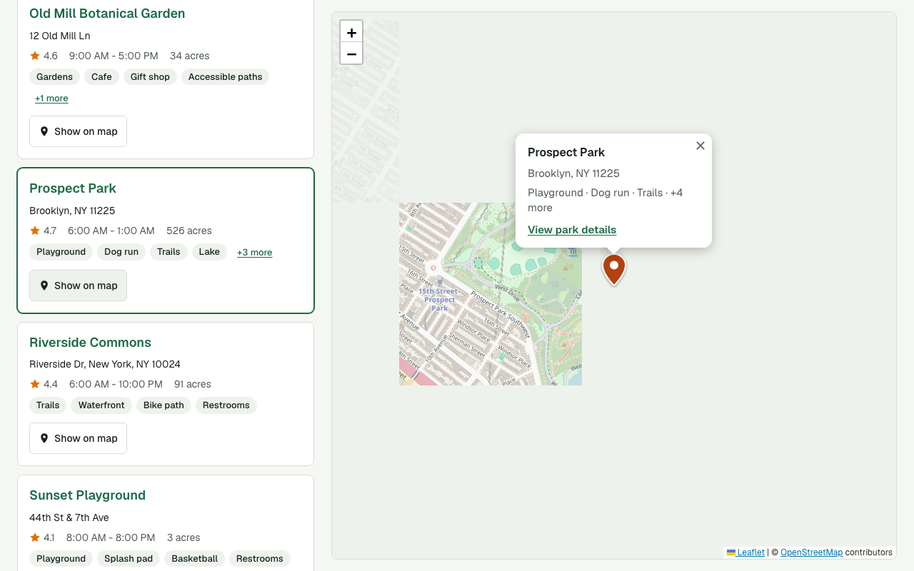
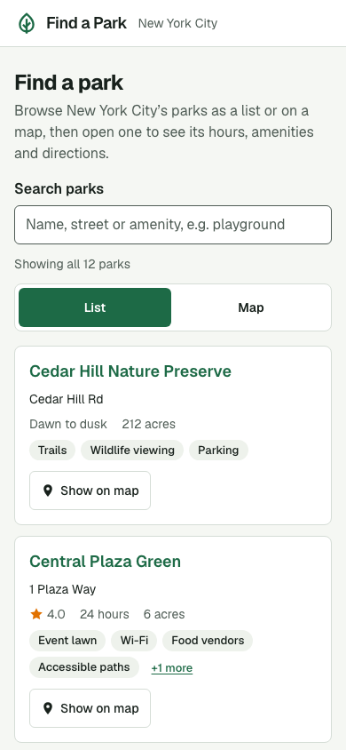
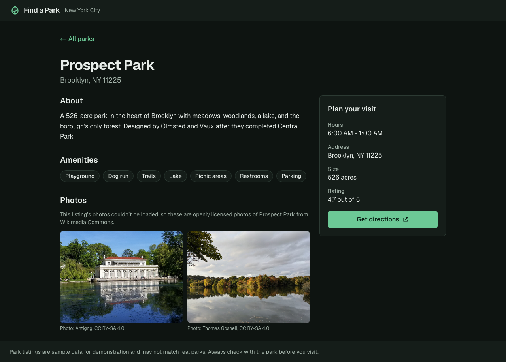
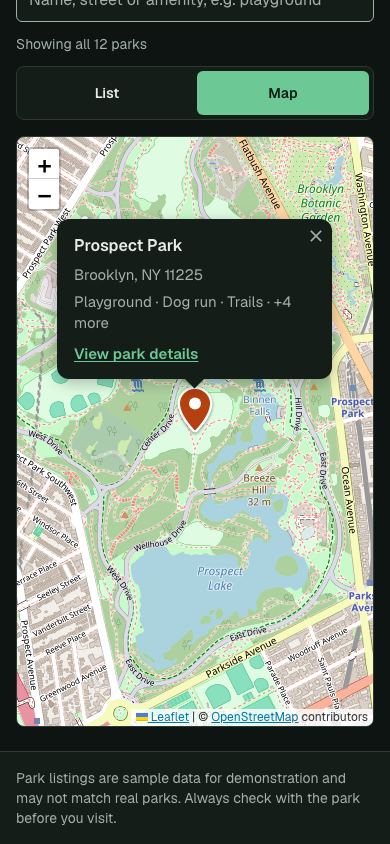

# Find a Park

A small web app that helps New York City residents find a park: browse a
list or a map, search, and open a park to see its hours, amenities, photos
and directions. Built for the Granicus "Find a Park" take-home.

| Desktop                                                               | Phone                                                             |
| --------------------------------------------------------------------- | ----------------------------------------------------------------- |
|   |     |
|  |  |

## Run it

Requirements: **Node 24** (pinned in `.nvmrc` and `.tool-versions`) and
**pnpm 10** (`corepack enable` will provide it). No API keys or accounts are
needed.

```bash
pnpm install
pnpm dev                                # http://localhost:3000
```

Production build: `pnpm build && pnpm start`.

### Checks

```bash
pnpm check                              # types, lint, formatting, unit tests
pnpm exec playwright install chromium   # once, for the browser tests
pnpm test:e2e                           # end-to-end + accessibility, desktop and phone
```

CI (`.github/workflows/ci.yml`) runs both on every push and pull request.

## What works

- **List** of all parks, alphabetical, with address, rating, hours, size and
  the first few amenities. Each park name links to its details page.
- **Map** (Leaflet + OpenStreetMap tiles) with a marker per park. Selecting a
  marker opens a summary with a link to the park's details, and highlights
  the park in the list. "Show on map" on a list card does the reverse.
- **Park details** page for each park: description, amenities, photos,
  hours, address, size, rating and a "Get directions" link (Google Maps, no
  key needed). Every page has its own URL and title.
- **Search** by name, street or amenity (e.g. "dog run", "brooklyn
  playground"), filtering the list and the map together.
- **Phone and desktop layouts.** On phones the list comes first and the map
  is one tap away; the map's code and tiles aren't downloaded until then.
- **Keyboard and screen reader support** for every task, including the map
  (see [Accessibility](#accessibility)).
- **Missing or bad data** never crashes a page or gets filled in with guesses
  (see [Data](#data)).
- **Failures degrade gracefully:** broken photos become labeled
  placeholders; if map tiles can't load, a notice appears and markers still
  work; if the map can't load at all, the list still works; unknown park URLs
  return a real 404 page.
- Light and dark mode, following the device setting.

Works without the resident's location; the app never asks for it.

## What I left out

- **Current location / "parks near me"** and **amenity filters**: optional in
  the brief; search covers the most common need ("playground", "dog run").
- **"Open now"**: the hours are free text ("Dawn to dusk", "24 hours",
  "6:00 AM - 1:00 AM"); interpreting them reliably needs structured data and
  a time zone, so they're shown exactly as published instead.
- **Marker clustering**: with 12 parks it isn't needed (see Known issues).
- **Search state in the URL** (shareable searches), a backend, accounts and
  deployment.

## Important decisions

- **Next.js 16 (App Router) + TypeScript**, starting from the official
  `create-next-app` template rather than a third-party boilerplate. Every
  page is prerendered at build time from the JSON file; there is no server
  data access at request time.
- **Leaflet with OpenStreetMap tiles.** No API key for the interviewer to
  supply, a small bundle, and markers that are keyboard-focusable out of the
  box. The trade-off: OSM's public tile servers don't allow production
  traffic, so the tile URL is configurable (`NEXT_PUBLIC_MAP_TILE_URL`,
  `NEXT_PUBLIC_MAP_TILE_ATTRIBUTION`) and must point at a tile provider
  before public use. I compared MapLibre + OpenFreeMap (prettier vector map,
  but ~5x the code and no built-in marker accessibility), Mapbox and Google
  (both need keys and billing).
- **The list and details pages are the primary interface; the map is an
  enhancement.** Everything a marker does can also be done from the list,
  which is what makes the map optional for keyboard, screen reader and
  low-bandwidth users.
- **One normalization step at the edge.** `src/lib/parks/normalize.ts` turns
  the raw JSON into a `Park` type where every optional field is a real value
  or `null`/`[]`. UI code never re-checks the raw shape, and swapping in an
  API later only changes `src/lib/parks/data.ts`.
- **Visit info first on the details page.** On phones, hours, address and
  directions come before the description and photos, because that's what
  most people opening a park page need.

## Data

The supplied `assets/parks.sample.json` is used unchanged (byte-identical).
I did not extend the schema.

How missing or invalid values are handled (`src/lib/parks/normalize.ts`):

| Situation                                        | What the app does                                  |
| ------------------------------------------------ | -------------------------------------------------- |
| Missing/blank text (description, hours, address) | Shows "Not listed" / "No description available."   |
| Missing or invalid coordinates (incl. 0,0)       | Park stays in the list, says it isn't on the map   |
| Empty or missing amenities/images                | "No amenities listed." / "No photos available."    |
| Image URL that isn't http(s), or fails to load   | Dropped / replaced with a "Photo unavailable" tile |
| Rating outside 0–5, non-positive acreage         | Treated as missing                                 |
| No usable id or name, or a duplicate id          | Record skipped (it can't be shown or linked to)    |

Every skipped record or ignored value is logged at build time so data
problems are visible. Issues I noticed in the sample data:

- **Cedar Hill Nature Preserve's coordinates (40.7128, -74.006) are exactly
  the commonly used "New York City" point at City Hall**, which suggests a
  placeholder. I show it where the data says rather than guess a location,
  and flag it here.
- All image URLs point to `images.example.com`, which doesn't exist, so every
  photo shows the "Photo unavailable" placeholder.
- Several addresses are partial ("Ridge Rd", "1 Plaza Way"), so directions
  use coordinates instead of addresses.
- Ratings have no stated source or scale; I assume 0–5 and label them only
  as "Rating".

## Accessibility

Target: WCAG 2.2 AA.

- Skip link; landmarks and a logical heading order on every page; one
  consistent, high-contrast focus outline (3px) everywhere.
- Every task works with a keyboard alone. Map markers are buttons with a
  descriptive name (e.g. "Prospect Park, Brooklyn, NY 11225. Show park
  summary."), open with Enter or Space, move focus into the popup, and
  Escape closes it and returns focus to where it came from. Leaflet doesn't
  do the last three on its own (`src/components/park-map.tsx`).
- Search results are announced via a live region; the List/Map toggle uses
  `aria-pressed`; touch targets are at least 44px.
- Color contrast is at least 4.5:1 for text in both color schemes; motion is
  reduced when the device asks for it; pages reflow without horizontal
  scrolling down to 320px (about 400% zoom).

## How I checked it

**Automated** (all run in CI):

- 47 unit and component tests (Vitest + Testing Library): data
  normalization for every missing/invalid case, search, formatting, the photo
  fallback and sparse park cards.
- 65 browser tests (Playwright) against a production build, on a desktop
  and a phone viewport: keyboard-only flows (list → details, markers with
  Enter/Space/Escape, skip link), search, the 404 page, missing data on the
  real sample parks, map tiles failing, the map code failing, and a
  regression test for going Back to the map. External requests are stubbed,
  so tests send no traffic to OpenStreetMap.
- axe-core WCAG 2.2 AA scans of each page state in light and dark mode, plus
  reflow checks at 320px.

**Manual**: I used the app in a browser at phone and desktop sizes, in both
color schemes, with mouse and keyboard only, and reviewed screenshots of each
screen (`pnpm screenshots` regenerates them).

**Problems the checks found** (each fixed and, where possible, covered by a
test):

1. **The map crashed after visiting a park and pressing Back.** Next.js 16
   keeps the previous page mounted but hidden (React `<Activity>`) and re-runs
   its effects on return; react-leaflet's `MapContainer` destroys the map in
   that cleanup but never recreates it. Fixed with a small
   `StableMapContainer` (`src/components/stable-map-container.tsx`), which
   also keeps your pan and zoom when you come back.
2. **Popup link contrast in dark mode was 3.5:1.** Leaflet's stylesheet
   overrode the link color. axe passed because it can't measure contrast over
   map tiles; I caught it reviewing screenshots.
3. **Screen readers read "Show on map : Prospect Park"** (with a stray
   pause) because the park name came from a visually hidden span; found by a
   failing Playwright test. Now an explicit `aria-label`.
4. **Keyboard focus didn't move into a popup the second time it opened**,
   because react-leaflet keeps popup content mounted after the first open.
5. **Escape didn't close popups** while focus was inside them (Leaflet only
   listens when the map itself is focused).

**Review**: _[Your own review notes go here — e.g. the code you read most
closely and how you checked it.]_

## Known issues

- At the zoomed-out city view on a phone, a few nearby markers overlap. Each
  marker is a 44×44px target, and every marker action is also available from
  the list (WCAG 2.5.8's "equivalent control" exception), so the overlap is
  accepted in the accessibility tests for markers only.
- After you open a park and go Back, that park stays highlighted on the map
  and in the list. This is deliberate ("you were here"), but it's a judgment
  call worth testing with residents.
- The OSM tile servers' usage policy rules them out for production (see
  Decisions).
- The Geist font is fetched from Google Fonts at build time, so
  `pnpm build` needs internet access.
- If Next.js discards the hidden home page after many navigations, the Leaflet
  map behind it is not explicitly destroyed (a small memory leak in long
  sessions; see the comment in `stable-map-container.tsx`).

## Time spent

_[Fill in.]_

## Next steps before public use

1. **Switch map tiles to a production tile provider** (and add its
   attribution); OSM's public servers forbid production use.
2. **Real data source and ownership**: an API or CMS the parks department
   maintains, validation at import time (the normalizer's warnings are a
   start), real photos with proper alt text, and a stated rating source.
3. **Usability testing with residents**, including screen reader users
   (VoiceOver, NVDA) and people on low-end phones — automated checks don't
   replace this.
4. **Hosting and operations**: deploy as a static site/CDN, error monitoring
   (the error boundaries already log), uptime checks, and a privacy-friendly
   analytics decision.
5. **Content and language**: plain-language review, translations for the
   city's main languages, and "Open now" once hours are structured.
6. **Security headers** (CSP allowing only the tile and image hosts).

## Project layout

```
assets/parks.sample.json        supplied data (unchanged)
src/lib/parks/                  normalize, search, format, data loading (+ tests)
src/app/page.tsx                home: list + map
src/app/parks/[id]/page.tsx     park details (prerendered per park)
src/components/park-explorer.tsx  search, List/Map toggle, shared selection
src/components/park-list.tsx    park cards
src/components/park-map.tsx     Leaflet map, accessible markers and popups
src/components/stable-map-container.tsx  Leaflet map that survives navigation
e2e/                            Playwright tests (incl. accessibility)
```

## AI use

_[Fill in: tools used, how you directed and reviewed them. Full transcripts
are included in the submission.]_
